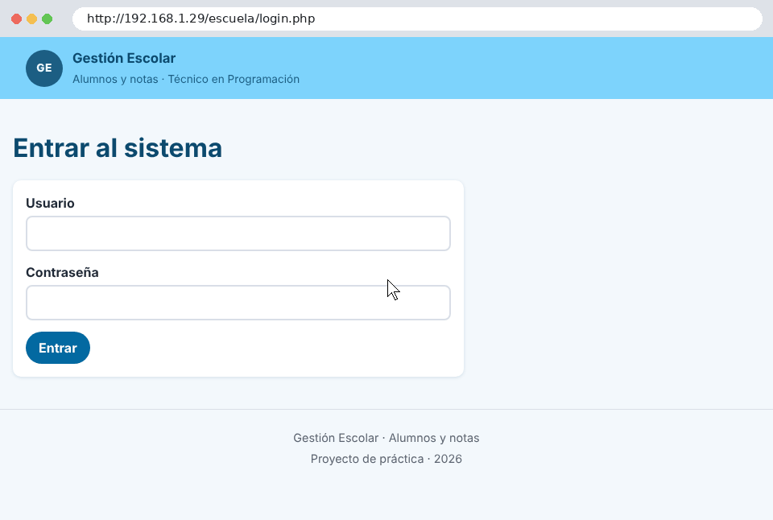
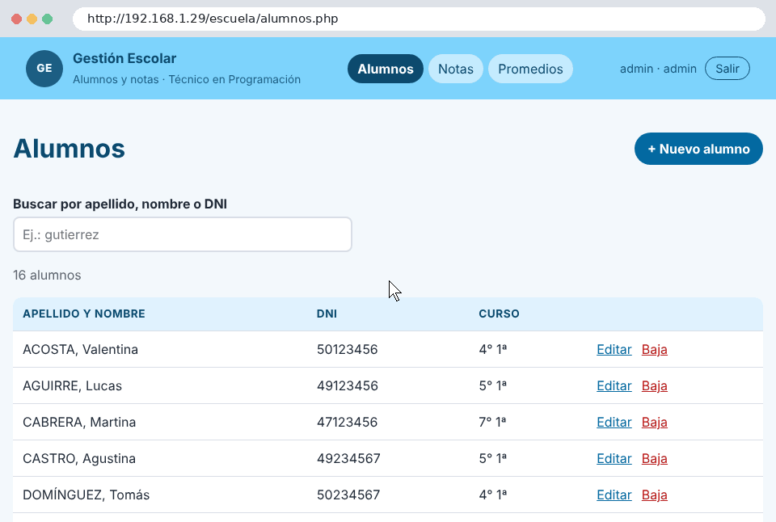
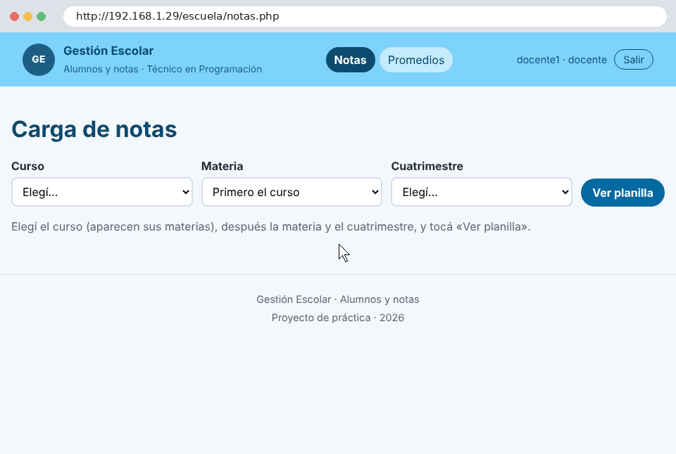
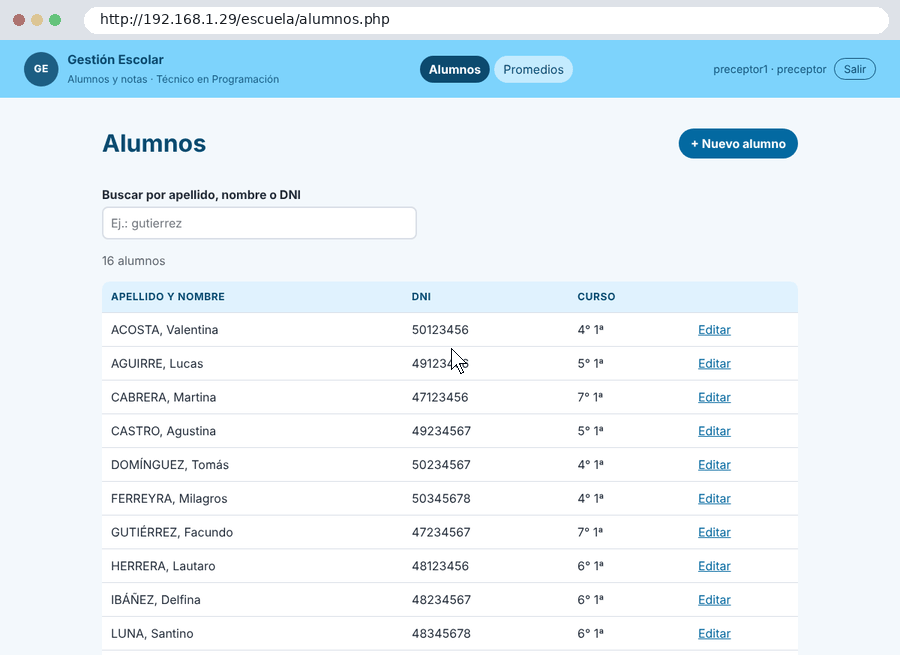

# Sistema de Gestión Escolar

<!-- TECNOLOGÍAS -->


<!-- FUNCIONALIDADES -->


## Descripción

Sistema web de gestión escolar para la especialidad **Técnico en Programación** (4.º a 7.º año). Permite gestionar los alumnos de cada curso, las materias de cada año y las notas por cuatrimestre.

Desarrollado con **PHP**, **MySQL** y **JavaScript**, sobre una arquitectura **LAMP** (Linux, Apache, MySQL y PHP).

Incluye un sistema de **autenticación con tres roles de usuario** (admin, preceptor y docente), operaciones **ABM de alumnos** (alta, baja y modificación), **carga de notas** por curso, materia y cuatrimestre, **promedios** con exportación en formato **CSV** compatible con Microsoft Excel, y un **buscador en vivo** que consulta al servidor con `fetch` y JSON.

> **Proyecto de práctica.** Los alumnos, DNI, notas y usuarios son datos ficticios, creados solo para probar el sistema. Las materias y los cursos son de ejemplo. No contiene datos reales de estudiantes ni está conectado a ningún sistema oficial de gestión.

## Qué hace

- **Login** con usuario y contraseña, guardada con `password_hash` (bcrypt). Si el usuario no existe o la contraseña está mal, el mensaje es el mismo.
- **Tres roles**: el **admin** puede todo; el **preceptor** maneja los alumnos; el **docente** carga las notas. Cada uno ve en el menú solo lo que puede usar, y si escribe a mano la dirección de otra página recibe un 403.
- **ABM de alumnos**: listado, alta, modificación y baja (la baja solo la hace el admin, con confirmación y por POST). DNI de 7 u 8 números, que no se repite.
- **Validación en el navegador** con JavaScript (al salir de cada campo, mientras se corrige y al enviar), con las mismas reglas que valida PHP en el servidor.
- **Carga de notas**: el docente elige curso, materia y cuatrimestre, y carga las notas de todo el curso juntas. Al cambiar el curso, las materias se actualizan solas. Si una nota no va del 1 al 10, no se guarda ninguna.
- **Promedios** de cada alumno en cada cuatrimestre y el **promedio final** (solo cuando están los dos cuatrimestres), con filtro por curso y **exportación a CSV** para Excel.
- **Buscador en vivo** por apellido, nombre o DNI: mientras se escribe, le pregunta al servidor y redibuja la tabla. Encuentra «Gutiérrez» escribiendo «gutierrez».
- **Token CSRF** en todos los formularios POST: un pedido armado fuera del sistema se rechaza con 403.
- **Backup automático** de la base: `scripts/backup.sh` hace la copia con `mysqldump`, la comprime y borra las de más de 7 días; `cron` lo corre todos los días.
- **Diagnóstico del servidor**: `scripts/diagnostico.sh` muestra en una pantalla la red (IP, gateway y DNS, y si responden), el estado de Apache, MySQL, Samba y cron, las reglas del firewall, el espacio en disco y el último backup.

## Demo

**Login: contraseña equivocada y entrada al sistema**



**Alta de un alumno, con la validación de JavaScript**


**Buscador en vivo: sin tildes, con ñ y por DNI**



**Carga de notas de 6° 1ª: las materias aparecen al elegir el curso**



**Promedios por cuatrimestre y final, filtrados por curso**


**El preceptor no ve «Notas», y si escribe la dirección a mano recibe un 403**



## Cómo está hecho

| Tema | Cómo se resuelve |
|---|---|
| Carpetas | En el servidor, Apache sirve **solo `public/`** (con un `Alias` en `config/escuela.conf`). `config/`, `src/`, `database/` y `scripts/` quedan fuera de la web. En XAMPP, donde se publica toda la carpeta, un `index.php` en la raíz manda a `public/` y esas cuatro carpetas tienen un `.htaccess` con `Require all denied` (403) |
| Conexión | **PDO** con `utf8mb4`, errores como excepciones (`ERRMODE_EXCEPTION`) y consultas preparadas nativas de MySQL |
| Contraseña de la base | En `config/config.php`, que **no está en el repositorio** (`.gitignore`). En el repo va `config.ejemplo.php` como modelo |
| Usuario de la base | `app_escuela`, con permisos mínimos (`SELECT`, `INSERT`, `UPDATE`, `DELETE`): la aplicación nunca se conecta como root |
| Sesiones | Cookie propia `ESCUELA` (no comparte la sesión con otros sistemas del mismo servidor), `HttpOnly`, `SameSite=Lax`, modo estricto y `session_regenerate_id(true)` al entrar |
| Roles | `exigir_rol(['admin', 'docente'])` al principio de cada página: sin login, al login; sin permiso, 403 |
| Inyección SQL | Todo dato de afuera va en **consultas preparadas**. Cursos, materias y cuatrimestres pasan además por una **lista blanca** |
| XSS | En PHP, todo lo que se muestra pasa por `e()` (`htmlspecialchars`). En JavaScript, los datos se escriben con `textContent`, nunca con `innerHTML` |
| Notas | `INSERT … ON DUPLICATE KEY UPDATE nota = :nota_nueva` (forma que aceptan MySQL y MariaDB) sobre el índice `UNIQUE` (alumno, materia, cuatrimestre), dentro de una **transacción**: se guardan todas o ninguna. La base además tiene `CHECK (nota BETWEEN 1 AND 10)` |
| Promedios | `AVG(n.nota)` con `GROUP BY a.id, n.cuatrimestre` y `LEFT JOIN`, para que el alumno sin notas también aparezca. Se redondea una sola vez, al mostrar |
| CSV | `fputcsv` sobre `php://output`, con BOM de UTF-8, punto y coma como separador y coma decimal. Un texto que empieza con `=`, `+`, `-` o `@` lleva un apóstrofo adelante, para que Excel no lo tome como fórmula |
| Buscador | `fetch` + `async/await` a `api/alumnos.php`, que responde JSON (y 401 o 403 en JSON, no la página de login). Espera 300 ms después de la última tecla: una búsqueda es un solo pedido. La base es `utf8mb4_unicode_ci`, que no distingue tildes y funciona en MySQL y en MariaDB |
| JavaScript | Mejora la página, pero no la reemplaza: sin JavaScript los formularios funcionan igual y PHP vuelve a validar todo |
| Git | Una función por commit. El buscador se hizo en la rama `feature/buscador` y se unió a `main` con un merge *fast-forward* |

El código tiene comentarios para facilitar la lectura de cada sección.

## Estructura

```
sistema-gestion-full/
├── instalar-xampp.bat        instala todo en XAMPP con doble clic (solo para probar)
├── index.php                 en XAMPP, manda a public/
├── config/
│   ├── config.ejemplo.php    modelo de configuración (copiar como config.php)
│   ├── config.xampp.php      configuración de demo para XAMPP
│   └── escuela.conf          Alias de Apache: /escuela → public/
├── database/
│   ├── escuela.sql           esquema de la base y datos de prueba
│   └── demo_xampp.sql        usuario de la base y usuarios de demo, solo para XAMPP
├── scripts/
│   ├── crear_usuario.php     crea usuarios desde la terminal, con password_hash
│   ├── backup.sh             copia de seguridad de la base (mysqldump + cron)
│   └── diagnostico.sh        estado del servidor: red, servicios, firewall, disco y backup
├── src/
│   ├── conexion.php          conectar(): la conexión PDO
│   ├── funciones.php         sesiones y roles, CSRF, validaciones, promedios, CSV, JSON
│   └── plantillas/           header, footer y el formulario del alumno
└── public/                   lo único que sirve Apache
    ├── index.php             manda a cada rol a su página
    ├── login.php, logout.php
    ├── alumnos.php           listado con el buscador en vivo
    ├── alumno_alta.php, alumno_editar.php, alumno_baja.php
    ├── notas.php             carga de notas
    ├── promedios.php         promedios por cuatrimestre y final
    ├── exportar.php          los promedios en CSV
    ├── api/alumnos.php       búsqueda de alumnos en JSON
    ├── css/styles.css        estilos, mobile first
    └── js/                   validar.js, notas.js, buscador.js
```

## Base de datos

| Tabla | Qué guarda |
|---|---|
| `usuarios` | usuario, hash de la contraseña y rol (`admin`, `preceptor`, `docente`) |
| `cursos` | 4° 1ª, 5° 1ª, 6° 1ª y 7° 1ª |
| `alumnos` | DNI (único), apellido, nombre y curso |
| `materias` | las materias de la especialidad, por año |
| `notas` | una por alumno, materia y cuatrimestre (1 o 2), del 1 al 10 |

Las claves foráneas cuidan los datos: no se puede borrar un curso con alumnos (`RESTRICT`) y si se da de baja un alumno se borran sus notas (`CASCADE`).

## Probarlo en XAMPP (Windows)

Para probar el sistema en la propia PC, sin configurar nada a mano.

1. Descargar el zip (botón verde **Code**, **Download ZIP**) y descomprimirlo en `C:\xampp\htdocs\`. Queda la carpeta `sistema-gestion-full-main`; se le puede sacar el `-main`.
2. Arrancar **Apache** y **MySQL** desde el panel de XAMPP.
3. Doble clic en `instalar-xampp.bat`. Crea la base `escuela` con los datos de prueba (si ya existía, la borra), el usuario de la base `app_escuela` y los usuarios de demo, y copia `config\config.xampp.php` como `config\config.php`.
4. Abrir la dirección que muestra al terminar: `http://localhost/sistema-gestion-full/` (o con el nombre que haya quedado la carpeta).

| Usuario | Contraseña | Rol |
|---|---|---|
| `admin` | `Admin-Demo-2026` | admin: puede todo |
| `preceptor1` | `Preceptor-Demo-2026` | preceptor: maneja los alumnos |
| `docente1` | `Docente-Demo-2026` | docente: carga las notas |

> **Solo para probar en la propia PC.** Estas contraseñas son públicas. `database/demo_xampp.sql` y `config/config.xampp.php` no se usan en un servidor: ahí la instalación es la de LAMP, con usuarios creados con `crear_usuario.php` y contraseñas que no están en ningún archivo.

Sin el instalador, a mano: en phpMyAdmin (`http://localhost/phpmyadmin`), pestaña **Importar**, cargar `database/escuela.sql` y después `database/demo_xampp.sql`; copiar `config\config.xampp.php` como `config\config.php`.

Si XAMPP no está en `C:\xampp` o el usuario `root` de MySQL tiene contraseña, el instalador lo avisa y dice qué línea cambiar.

## Instalación en un servidor LAMP (Ubuntu)

Requisitos: Apache 2.4, PHP 8.1 o superior con `pdo_mysql` (paquete `php-mysql`) y MySQL 8.0 o superior.

1. Clonar el repositorio en `/var/www/sistema-gestion-full` y darle el grupo de Apache:
   ```bash
   sudo chown -R $USER:www-data /var/www/sistema-gestion-full
   ```
2. Crear la base con los datos de prueba (si ya existe una base `escuela`, la borra):
   ```bash
   sudo mysql < database/escuela.sql
   ```
3. Crear el usuario de la aplicación, en `sudo mysql`:
   ```sql
   CREATE USER 'app_escuela'@'localhost' IDENTIFIED BY 'una-contraseña-segura';
   GRANT SELECT, INSERT, UPDATE, DELETE ON escuela.* TO 'app_escuela'@'localhost';
   ```
4. Crear la configuración real, poner la contraseña y dejarla solo para Apache:
   ```bash
   cp config/config.ejemplo.php config/config.php
   chmod 640 config/config.php
   ```
5. Publicar `public/` en `http://IP-DEL-SERVIDOR/escuela/`:
   ```bash
   sudo cp config/escuela.conf /etc/apache2/conf-available/
   sudo a2enconf escuela
   sudo apache2ctl configtest
   sudo systemctl reload apache2
   ```
6. Crear los usuarios desde la terminal. Pide la contraseña dos veces y no la muestra (12 caracteres o más):
   ```bash
   php scripts/crear_usuario.php admin admin
   php scripts/crear_usuario.php preceptor1 preceptor
   php scripts/crear_usuario.php docente1 docente
   ```
7. Abrir `http://IP-DEL-SERVIDOR/escuela/`.

## Backup automático

`scripts/backup.sh` copia la base `escuela` con `mysqldump --single-transaction` (copia consistente, sin bloquear el sistema), la comprime con gzip, comprueba el comprimido y borra las copias de más de 7 días. Las copias quedan en `/var/backups/escuela`, que solo puede leer root, y cada resultado queda en el registro del sistema.

1. Instalar el script como root (cron corre una copia que solo root puede modificar):
   ```bash
   sudo install -m 755 -o root -g root scripts/backup.sh /usr/local/sbin/backup-escuela.sh
   ```
2. Probarlo a mano:
   ```bash
   sudo /usr/local/sbin/backup-escuela.sh
   ```
3. Programarlo con `sudo crontab -e`, todos los días a las 2:30:
   ```
   30 2 * * * /usr/local/sbin/backup-escuela.sh
   ```
4. Ver el resultado de cada copia:
   ```bash
   journalctl -t backup-escuela
   ```

**Restaurar una copia** en una base de prueba, sin tocar la real (el archivo no trae `CREATE DATABASE`):

```bash
sudo mysql -e "CREATE DATABASE escuela_prueba CHARACTER SET utf8mb4 COLLATE utf8mb4_unicode_ci"
sudo gunzip -c /var/backups/escuela/escuela_AAAA-MM-DD_HHMM.sql.gz | sudo mysql escuela_prueba
sudo mysql -e "CHECKSUM TABLE escuela.notas, escuela_prueba.notas"
```

Si los dos números coinciden, la copia tiene los mismos datos. La base usa `utf8mb4_unicode_ci`, así que la copia también se puede cargar en MariaDB (XAMPP).

## Diagnóstico del servidor

`scripts/diagnostico.sh` revisa el servidor con un solo comando y marca cada punto con `[ OK  ]` o `[FALLA]`:

- **Red:** placa, IP y si vino por DHCP; si responden el gateway y cada servidor DNS, y si el DNS traduce un nombre.
- **Servicios:** `apache2`, `mysql`, `smbd` y `cron` activos.
- **Firewall:** si `ufw` está activo y sus reglas.
- **Disco:** uso de la partición principal (avisa desde el 80 %).
- **Backup:** la copia más nueva de `/var/backups/escuela` (avisa si tiene más de 26 horas), la línea de cron y el último mensaje del registro.

Se corre desde la carpeta del repo, con sudo (las reglas de `ufw` y la carpeta de los backups son solo de root):

```bash
sudo scripts/diagnostico.sh
```

Ejemplo de la parte de red en el servidor de prueba:

```
Diagnóstico de gestion-srv · 26/11/2026 17:37

== Red ==
  Placa:    enp0s3
  IP:       192.168.1.29/24
  Origen:   DHCP (la IP puede cambiar: conviene una reserva)
  [ OK  ] Gateway 192.168.1.1 responde
  [ OK  ] DNS 8.8.8.8 responde
  [ OK  ] DNS 1.1.1.1 responde
  [ OK  ] El DNS traduce google.com
...
Resultado: todo OK
```

Termina con código 0 si está todo bien y 1 si encontró algún problema, así se puede usar desde cron o desde otro script.

## Licencia

[MIT](https://github.com/Prof-NkoCussi/infraestructura-redes-lamp/blob/main/LICENSE) © Prof. Nicolás A. Cussi\
*Full Stack Developer • Data Science • AI*
