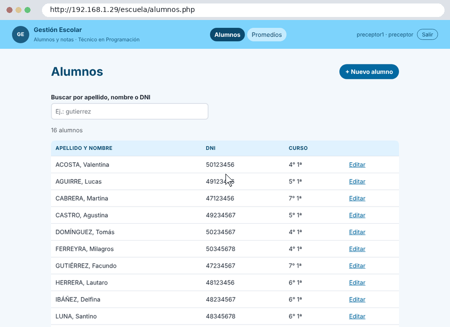
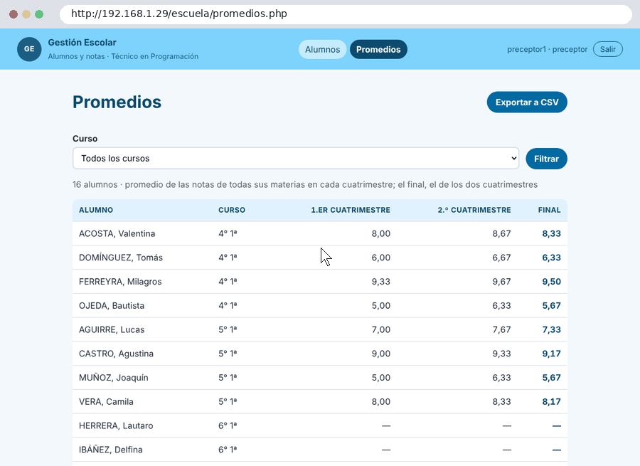

# Gestión Escolar

Sistema web de gestión escolar para el **Técnico en Programación** (4.º a 7.º año): alumnos, cursos, materias y notas por cuatrimestre. Está hecho con **PHP**, **MySQL** y **JavaScript** sobre un servidor **LAMP** (Linux, Apache, MySQL, PHP). Tiene **login con tres roles**, el **ABM de alumnos**, la **carga de notas** por curso, materia y cuatrimestre, los **promedios** con exportación a **CSV** y un **buscador en vivo** que consulta al servidor con `fetch` y JSON.

> Proyecto de práctica: todos los datos son ficticios.

## Qué hace

- **Login** con usuario y contraseña, guardada con `password_hash` (bcrypt). Si el usuario no existe o la contraseña está mal, el mensaje es el mismo.
- **Tres roles**: el **admin** puede todo; el **preceptor** maneja los alumnos; el **docente** carga las notas. Cada uno ve en el menú solo lo que puede usar, y si escribe a mano la dirección de otra página recibe un 403.
- **ABM de alumnos**: listado, alta, modificación y baja (la baja solo la hace el admin, con confirmación y por POST). DNI de 7 u 8 números, que no se repite.
- **Validación en el navegador** con JavaScript (al salir de cada campo, mientras se corrige y al enviar), con las mismas reglas que valida PHP en el servidor.
- **Carga de notas**: el docente elige curso, materia y cuatrimestre, y carga las notas de todo el curso juntas. Al cambiar el curso, las materias se actualizan solas. Si una nota no va del 1 al 10, no se guarda ninguna.
- **Promedios** de cada alumno en cada cuatrimestre y el **promedio final** (solo cuando están los dos cuatrimestres), con filtro por curso y **exportación a CSV** para Excel.
- **Buscador en vivo** por apellido, nombre o DNI: mientras se escribe, le pregunta al servidor y redibuja la tabla. Encuentra «Gutiérrez» escribiendo «gutierrez».
- **Token CSRF** en todos los formularios POST: un pedido armado fuera del sistema se rechaza con 403.

## Demo

**Login: contraseña equivocada y entrada al sistema**


**Alta de un alumno, con la validación de JavaScript**



**Buscador en vivo: sin tildes, con ñ y por DNI**


**Carga de notas de 6° 1ª: las materias aparecen al elegir el curso**


**Promedios por cuatrimestre y final, filtrados por curso**



**El preceptor no ve «Notas», y si escribe la dirección a mano recibe un 403**


## Cómo está hecho

| Tema | Cómo se resuelve |
|---|---|
| Carpetas | Apache sirve **solo `public/`** (con un `Alias` en `config/escuela.conf`). `config/`, `src/`, `database/` y `scripts/` quedan fuera de la web |
| Conexión | **PDO** con `utf8mb4`, errores como excepciones (`ERRMODE_EXCEPTION`) y consultas preparadas nativas de MySQL |
| Contraseña de la base | En `config/config.php`, que **no está en el repositorio** (`.gitignore`). En el repo va `config.ejemplo.php` como modelo |
| Usuario de la base | `app_escuela`, con permisos mínimos (`SELECT`, `INSERT`, `UPDATE`, `DELETE`): la aplicación nunca se conecta como root |
| Sesiones | Cookie propia `ESCUELA` (no comparte la sesión con otros sistemas del mismo servidor), `HttpOnly`, `SameSite=Lax`, modo estricto y `session_regenerate_id(true)` al entrar |
| Roles | `exigir_rol(['admin', 'docente'])` al principio de cada página: sin login, al login; sin permiso, 403 |
| Inyección SQL | Todo dato de afuera va en **consultas preparadas**. Cursos, materias y cuatrimestres pasan además por una **lista blanca** |
| XSS | En PHP, todo lo que se muestra pasa por `e()` (`htmlspecialchars`). En JavaScript, los datos se escriben con `textContent`, nunca con `innerHTML` |
| Notas | `INSERT … ON DUPLICATE KEY UPDATE` sobre el índice `UNIQUE` (alumno, materia, cuatrimestre), dentro de una **transacción**: se guardan todas o ninguna. La base además tiene `CHECK (nota BETWEEN 1 AND 10)` |
| Promedios | `AVG(n.nota)` con `GROUP BY a.id, n.cuatrimestre` y `LEFT JOIN`, para que el alumno sin notas también aparezca. Se redondea una sola vez, al mostrar |
| CSV | `fputcsv` sobre `php://output`, con BOM de UTF-8, punto y coma como separador y coma decimal. Un texto que empieza con `=`, `+`, `-` o `@` lleva un apóstrofo adelante, para que Excel no lo tome como fórmula |
| Buscador | `fetch` + `async/await` a `api/alumnos.php`, que responde JSON (y 401 o 403 en JSON, no la página de login). Espera 300 ms después de la última tecla: una búsqueda es un solo pedido. La base es `utf8mb4_0900_ai_ci`, que no distingue tildes |
| JavaScript | Mejora la página, pero no la reemplaza: sin JavaScript los formularios funcionan igual y PHP vuelve a validar todo |
| Git | Una función por commit. El buscador se hizo en la rama `feature/buscador` y se unió a `main` con un merge *fast-forward* |

El código tiene comentarios para facilitar la lectura de cada sección.

## Estructura

```
sistema-gestion-full/
├── config/
│   ├── config.ejemplo.php    modelo de configuración (copiar como config.php)
│   └── escuela.conf          Alias de Apache: /escuela → public/
├── database/escuela.sql      esquema de la base y datos de prueba
├── scripts/crear_usuario.php crea usuarios desde la terminal, con password_hash
├── src/
│   ├── conexion.php          conectar(): la conexión PDO
│   ├── funciones.php         sesiones y roles, CSRF, validaciones, promedios, CSV, JSON
│   └── plantillas/           header, footer y el formulario del alumno
└── public/                   lo único que sirve Apache
    ├── index.php             manda a cada rol a su página
    ├── login.php, logout.php
    ├── alumnos.php           listado con el buscador en vivo
    ├── alumno_alta.php, alumno_editar.php, alumno_baja.php
    ├── notas.php             carga de notas
    ├── promedios.php         promedios por cuatrimestre y final
    ├── exportar.php          los promedios en CSV
    ├── api/alumnos.php       búsqueda de alumnos en JSON
    ├── css/styles.css        estilos, mobile first
    └── js/                   validar.js, notas.js, buscador.js
```

## Base de datos

| Tabla | Qué guarda |
|---|---|
| `usuarios` | usuario, hash de la contraseña y rol (`admin`, `preceptor`, `docente`) |
| `cursos` | 4° 1ª, 5° 1ª, 6° 1ª y 7° 1ª |
| `alumnos` | DNI (único), apellido, nombre y curso |
| `materias` | las materias de la especialidad, por año |
| `notas` | una por alumno, materia y cuatrimestre (1 o 2), del 1 al 10 |

Las claves foráneas cuidan los datos: no se puede borrar un curso con alumnos (`RESTRICT`) y si se da de baja un alumno se borran sus notas (`CASCADE`).

## Instalación en un servidor LAMP (Ubuntu)

Requisitos: Apache 2.4, PHP 8.1 o superior con `pdo_mysql` (paquete `php-mysql`) y MySQL 8.0.19 o superior.

1. Clonar el repositorio en `/var/www/sistema-gestion-full` y darle el grupo de Apache:
   ```bash
   sudo chown -R $USER:www-data /var/www/sistema-gestion-full
   ```
2. Crear la base con los datos de prueba (si ya existe una base `escuela`, la borra):
   ```bash
   sudo mysql < database/escuela.sql
   ```
3. Crear el usuario de la aplicación, en `sudo mysql`:
   ```sql
   CREATE USER 'app_escuela'@'localhost' IDENTIFIED BY 'una-contraseña-segura';
   GRANT SELECT, INSERT, UPDATE, DELETE ON escuela.* TO 'app_escuela'@'localhost';
   ```
4. Crear la configuración real, poner la contraseña y dejarla solo para Apache:
   ```bash
   cp config/config.ejemplo.php config/config.php
   chmod 640 config/config.php
   ```
5. Publicar `public/` en `http://IP-DEL-SERVIDOR/escuela/`:
   ```bash
   sudo cp config/escuela.conf /etc/apache2/conf-available/
   sudo a2enconf escuela
   sudo apache2ctl configtest
   sudo systemctl reload apache2
   ```
6. Crear los usuarios desde la terminal. Pide la contraseña dos veces y no la muestra (12 caracteres o más):
   ```bash
   php scripts/crear_usuario.php admin admin
   php scripts/crear_usuario.php preceptor1 preceptor
   php scripts/crear_usuario.php docente1 docente
   ```
7. Abrir `http://IP-DEL-SERVIDOR/escuela/`.

## Instalación en XAMPP (Windows)

1. Copiar la carpeta en `C:\xampp\htdocs\sistema-gestion-full` y arrancar Apache y MySQL desde el panel de XAMPP.
2. En phpMyAdmin (`http://localhost/phpmyadmin`), pestaña **Importar**, cargar `database/escuela.sql`.
3. Copiar `config\config.ejemplo.php` como `config\config.php` y completar el usuario y la contraseña. XAMPP trae `root` sin contraseña: sirve para practicar en la propia PC, nunca en un servidor.
4. Crear el primer usuario: en el panel de XAMPP, botón **Shell**, entrar a la carpeta y correr `php scripts/crear_usuario.php admin admin`. En Windows la contraseña se ve mientras se escribe.
5. Abrir `http://localhost/sistema-gestion-full/public/`.

## Licencia

[MIT](https://github.com/Prof-NkoCussi/infraestructura-redes-lamp/blob/main/LICENSE) © Prof. Nicolás A. Cussi\
*Full Stack Developer • Data Science • AI*
